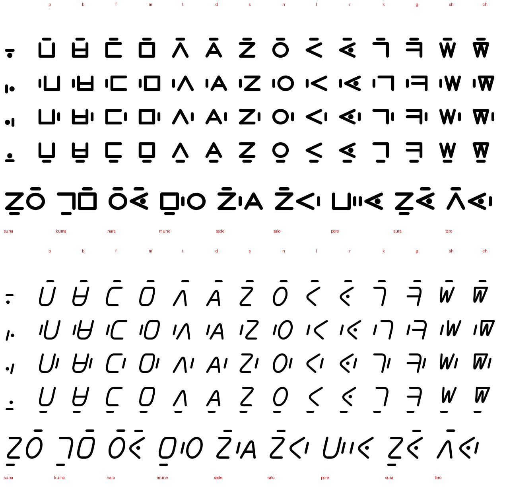

# Guía de estilo de Owee Script 3.4

Para escribir Owee a mano, en pancartas o en pantalla, cada quien puede darle **su
estilo**. Lo único que no se negocia es que cada glifo se pueda **distinguir de los
demás**. Esta guía dice qué rasgo define cada glifo (no cambiar) y qué puede variar.

## 1. Cómo se arma una sílaba
Owee se escribe **en línea**: una sílaba es la **consonante** (forma grande) seguida, a su
derecha y en el mismo renglón, de la **marca de la vocal** (pequeña, suelta, con aire).
Se lee de izquierda a derecha, consonante y vocal, sin saltar arriba ni abajo.

| Vocal | Marca |
|---|---|
| a | barra **vertical** `|` (horizontal parecería un guion entre sílabas) |
| e | viga `エ` |
| o | anillo `○` |
| u | `ᚢ` |

La marca de vocal **no toca** la consonante: deja aire. Entre sílabas hay más aire que
entre la consonante y su vocal, para que se vea qué vocal pertenece a qué consonante. Una
vocal sola (A, E, O, U) es sólo su marca, más grande, en el centro.

La disposición anterior (vocal alrededor: a arriba, e izquierda, o derecha, u abajo) sigue
disponible con `OWEE_V4_LAYOUT=around`.

## 2. Lo que no puede cambiar y lo que sí
| Se puede variar | No se puede variar |
|---|---|
| Tamaño, estiramiento (pancartas), inclinación | La **silueta**: abierta o cerrada, número de trazos |
| Grosor, remates, serifas | Si lleva barra, punto o raya, y **dónde** |
| Esquinas vivas o redondeadas | Qué marca de vocal usa |
| Un trazo continuo o varios levantando el lápiz | Que ninguna se pueda leer como otra al torcerla |

**Regla de oro:** si al girar o espejar un glifo se lee como otro, está mal diseñado o mal
escrito. Ningún glifo es el giro de otro.

## 3. Consonantes
Parejas: la **barra al medio** marca la sonora (b, d, g).

| Cons. | Forma | Rasgo que la define | Se confunde con… | Cómo evitarlo |
|---|---|---|---|---|
| **p** | `⊔` copa abierta arriba | abierta arriba, sin barra | b | b lleva una barra completa de lado a lado |
| **b** | `⊔` con barra | copa + barra al medio | p, m | la barra cruza toda la copa; m está cerrada arriba |
| **f** | `T` | barra superior + palo central | e (エ) | f es grande; la viga de e es pequeña y tiene base |
| **m** | cuadro con raya vertical | cerrada, dos cuartos | n | la raya es vertical y el cuadro tiene esquinas; n es redonda con raya horizontal |
| **t** | `Λ` | dos patas en punta | d | d lleva barra entre las patas |
| **d** | `A` | punta + barra al medio | t | la barra va de pata a pata |
| **s** | `Z` | barra arriba, barra abajo, diagonal | z/N | arriba va hacia la derecha; en la mano puede ser `S` |
| **n** | `Θ` círculo con barra | redonda, cerrada, barra horizontal | o, m | la barra la cruza entera; o es mucho más chica y sin barra |
| **l** | `Y` | horquilla con palo | r | l no lleva punto |
| **r** | `Y` con punto | horquilla + punto entre los brazos | l | el punto va dentro de la horquilla |
| **k** | `┐` esquina | una esquina: arriba y derecha | g | g lleva barra |
| **g** | `┐` con barra | esquina + barra al medio | k | barra completa |
| **sh** | `X` | dos diagonales que se cruzan | ch | ch lleva además una raya vertical |
| **ch** | `✱` | X + raya vertical | sh | la raya vertical cruza el centro |

## 4. Vocales
| Vocal | Rasgo que la define | Origen | Se confunde con… | Cómo evitarlo |
|---|---|---|---|---|
| **a** | una sola raya | Ogham, hebreo | el guion, la barra de b | siempre a un lado de la consonante, sola |
| **e** | tres trazos (viga en I) | katakana エ | la I latina | siempre pequeña, junto a una consonante |
| **o** | círculo pequeño y cerrado | omicron griega | n, el cero | n es grande y lleva barra |
| **u** | dos patas unidas por arriba con esquina | runa Uruz ᚢ | n latina | la esquina es recta y las patas son desiguales |

Detalle en `VOCALES_v4.md`.

## 5. Marcas
- **Nombre propio `ᚠ`** (runa Fehu): va **antes** del nombre y lo distingue de una palabra
  común que suene igual (`Kale` nombre, `kale` «amarillo»). En romano es la mayúscula inicial.
  Rasgo: un palo con dos ramas hacia arriba y la derecha.
- **Nexo de compuesto `‿`** (el «tie» de la fonética): va **entre** los bloques de un compuesto
  y lo distingue de las mismas palabras sueltas (`sade-kelo` «año», `sade kelo` «sol, ciclo»).
  En romano es el guion. Rasgo: una curva pequeña y baja, abierta hacia arriba.

## 6. Parecidos con otros símbolos (a tener en cuenta)
Los glifos son caracteres propios (zona de uso privado), así que **no chocan con símbolos
del teclado**; el riesgo es sólo visual al leer.

| Glifo | Se parece a | Riesgo | Qué hacer |
|---|---|---|---|
| a `—` | signo menos, guion | bajo: va junto a una consonante | no usarla sola en cuentas |
| nombre `ᚠ` | la F latina | bajo | va siempre pegada al principio de un nombre |
| nexo `‿` | una sonrisa pequeña | bajo | va siempre baja, entre dos bloques |
| sh `X` | signo por `×` | bajo | el contexto lo resuelve (va con vocal) |
| ch `✱` | asterisco | bajo | ídem |
| t `Λ` | «y» lógico, lambda | muy bajo | |
| k `┐` | negación lógica `¬` | muy bajo | |
| d `A`, s `Z`, o `○`, e `エ` | letras latinas | informativo | cada una es sólo una forma |
| n `Θ`, o `○` | cero de los números Owee (óvalo) | bajo: los números van en tramos de dígitos | si molesta, rediseñar el cero |

## 7. Qué se revisó
`auditar_glifos_v4.py` compara cada par de glifos, tal cual y girado o espejado. En la
primera versión había tres parejas de consonantes que eran giros una de otra (p/f, t/l,
d/r); se cambiaron f, l, r y n. Ahora **ningún par de consonantes ajenas es giro de otro**.
Ya no queda ninguna coincidencia exacta: la marca de nombre y el nexo se rediseñaron (`=` se parecía al signo igual, y la barra baja del nexo era casi la `a`).
