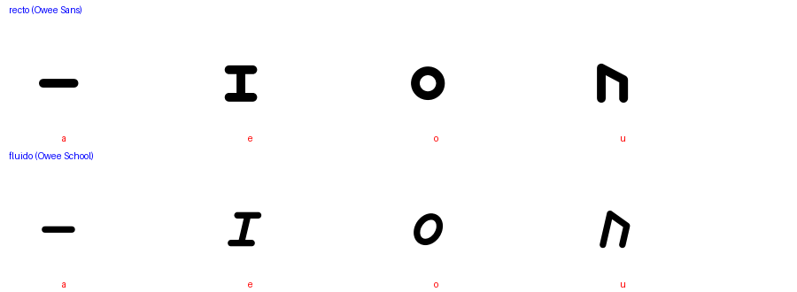

# Las vocales de Owee Script 

Cada vocal tiene una **forma propia** que no depende de la posición ni de girar o
espejar otra forma, y cada forma viene de una escritura real donde esa forma
representa **esa misma vocal**. En la disposición en línea las cuatro vocales van a la derecha de la consonante;
sólo la a pasa de barra horizontal a **barra vertical**, para no leerse como guion.
(Disposición `around`: a arriba, e izquierda, o derecha, u abajo.)

| Vocal | Forma en Owee | Origen | Cómo recordarla |
|---|---|---|---|
| **a** | barra vertical `|` (horizontal `—` en `around`) | Ogham: la **a** es una sola muesca (ᚐ). En hebreo, la raya (patah) marca la **a**. | Una sola raya: la vocal más simple. |
| **e** | viga en I `エ` | Katakana: **エ** se lee «e». | Una viga con dos tapas. |
| **o** | anillo `○` | Alfabeto griego: la **ο** (ómicron) es un círculo; también la o latina. | La boca redonda al decir «o». |
| **u** | `ᚢ` | Runas germánicas (Futhark antiguo): **ᚢ** (Uruz) es la **u**. | Una «n» angulosa abierta por abajo, como una copa al revés. |

## Por qué estas cuatro
- **No se confunden entre sí:** una línea, una viga, un círculo y un ángulo con dos patas.
- **No se parecen a otros signos:** la cruz `+` se descartó por parecerse a un signo de suma, y el triángulo por parecer un punto.
- **No se parecen a las consonantes**, que son formas grandes; las vocales son marcas pequeñas.
- **Se escriben en 1 o 3 trazos.**

## Descartadas
- ト (katakana «to») para la e: no es una e; se dejó sólo como variante (`OWEE_V4_E=tee`).
- Cruz `+`, triángulo, doble barra `=`, コ, ヘ, Y; en la u, ᛏ ᛞ ᚦ.
- Giro de una misma forma (silabario cree) y palo con marca en un lado (Hangul): distinguen sólo por posición.

Las variantes se prueban con `OWEE_V4_E` (`kata`, `tee`, `ko`, `he`, `y`, `plus`, `bars`) y
`OWEE_V4_U` (`uruz`, `tiwaz`, `dagaz`, `thurs`, `triangle`). Vea `README.md`.
